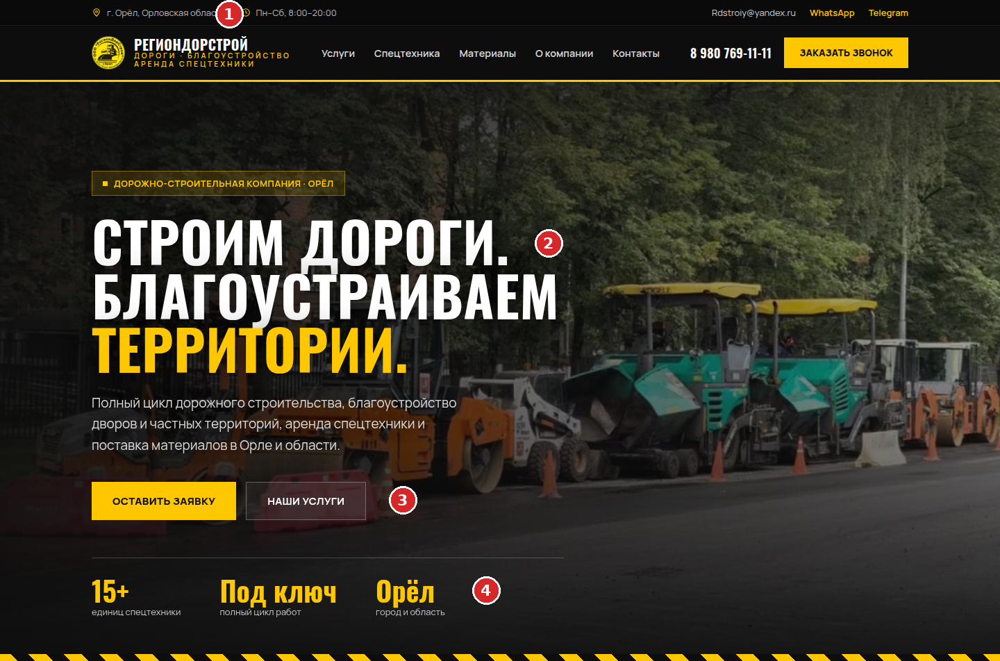
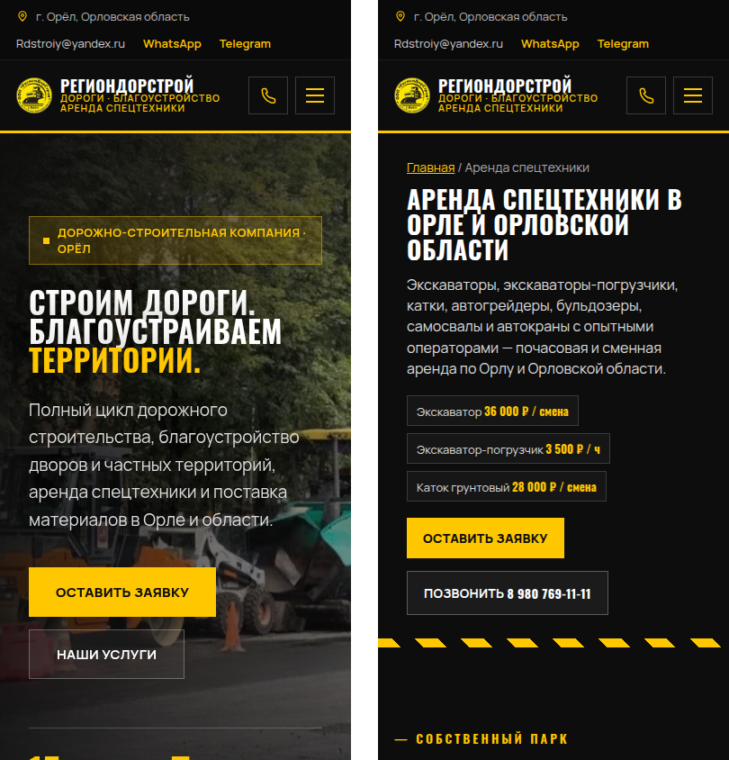
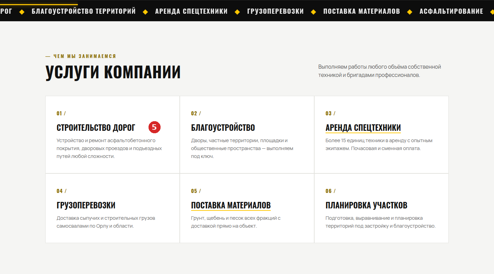
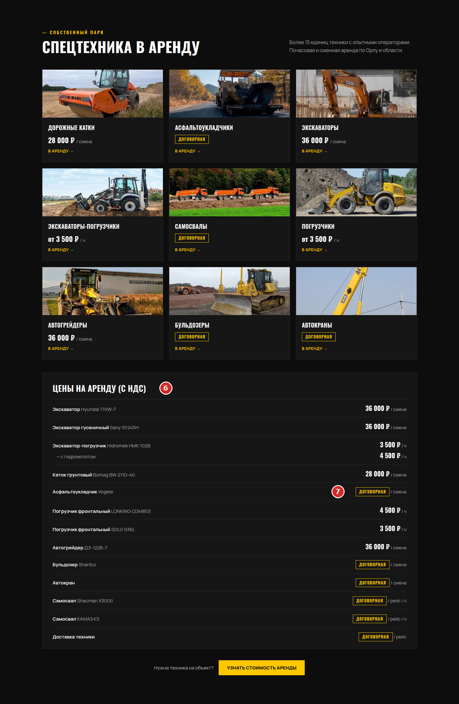
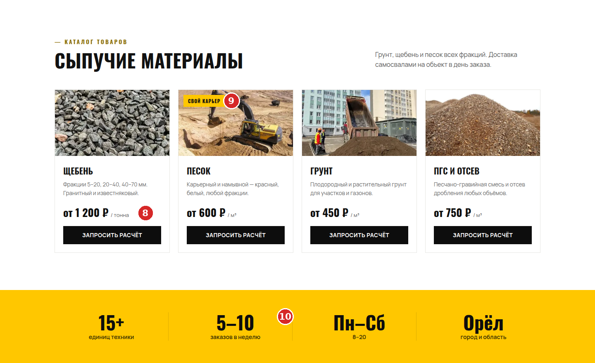
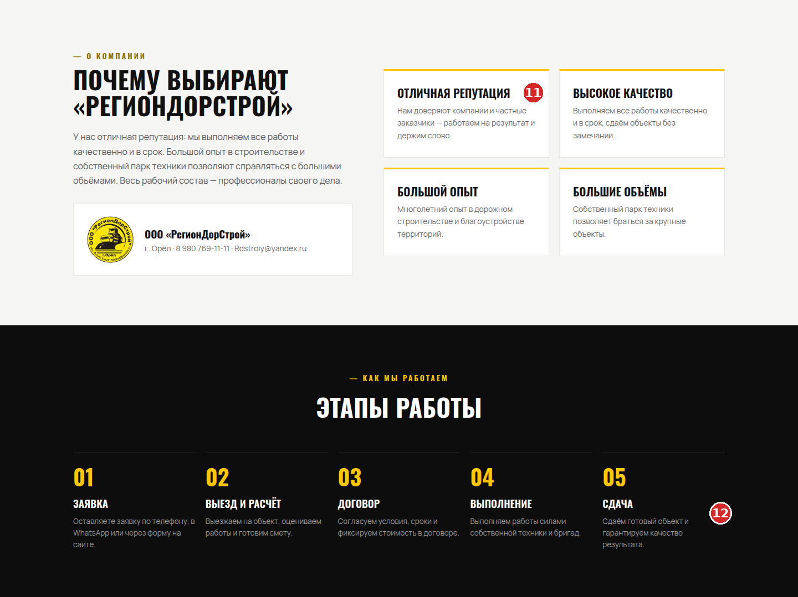
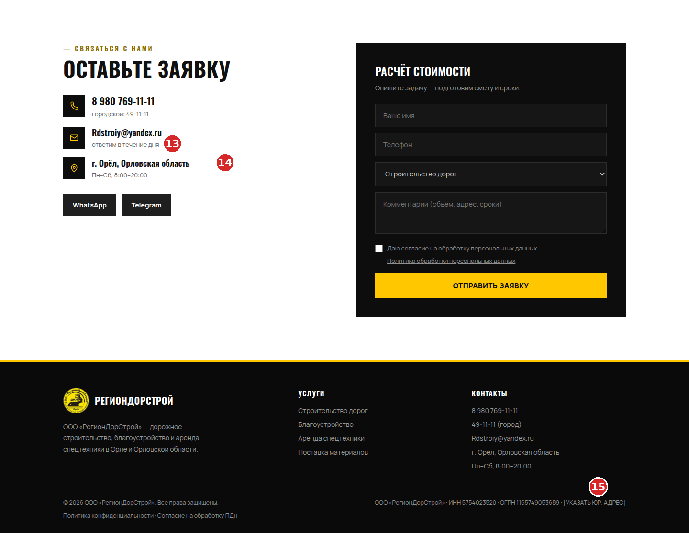

# Главная regiondorstroy.com: что поправить

Смотрел сайт 28 октября с компьютера и с телефона. На скриншотах проставил номера, ниже по ним и пишу. Кроме меня сайт прошли 16 разных «клиентов», каждый с телефона и с компьютера, всего 32 раза: прораб, дачник, снабженец, председатель СНТ, управляющая УК и другие. Каждую их жалобу потом отдельно проверили на живом сайте, ложные я выкинул.

## Если коротко

По аренде, честно, у нас лучше, чем у конкурентов: цена у каждой машины и с НДС, а у них «от 1900 руб./час» или вообще ничего. И позвонить просто, на странице аренды номер прямо на первом экране.

А вот с ответами на вопросы плохо. Из 32 прогонов до конца задачу решили 6, остальные 26 застряли на полпути. Застревали почти всегда на одном и том же:

1. Нет адреса. В подвале висит «[УКАЗАТЬ ЮР. АДРЕС]», это всплыло в 26 прогонах из 32. Для снабженца и для администрации это повод не звонить вообще.
2. Нет условий. Что входит в смену, сколько стоит доставка, есть ли НДС на щебень, какой минимальный заказ. Доставку упоминали в 18 прогонах из 32.
3. Нет асфальта и благоустройства как услуг. Есть строчка в карточке «Строительство дорог» и слово в бегущей строке. Ни цены за м², ни страницы.
4. Нет ни одного объекта и ни одного отзыва. Вместо них «отличная репутация».

Тут я сам ничего не сделаю, нужны ваши ответы. Что написать и куда, я собрал в отдельный список дел (файл OWNER-ACTIONS), там у каждого пункта есть путь в админке.

## Что уже поправили 28 октября

Мелочи, которые можно было поправить без вас, мы поправили в тот же день и уже выложили:

- На телефоне в шапке появилась кнопка-трубка, раньше номера без прокрутки не было видно.
- Шапка теперь остаётся сверху при прокрутке. Раньше она уезжала и на телефоне, и на компьютере.
- На страницах аренды и материалов в первом экране стоят три цены и кнопка «Позвонить 8 980 769-11-11».
- «В аренду» на карточках техники раньше была просто надписью, теперь открывает заявку с названием машины.
- В окне «Запросить расчёт» появилось поле «Объём, адрес, сроки». Раньше окно обещало посчитать доставку, а адрес написать было негде.
- Карточки больше не проявляются с задержкой, «договорная» везде пишется с единицей, текст согласия крупнее.
- Без галочки согласия теперь видно по-русски, что её надо поставить.

## По блокам

### Шапка и первый экран

**1.** В верхней полосе «г. Орёл, Орловская область», и всё. Улицы нет ни здесь, ни ниже. Яндекс по такому адресу регион сайту не присвоит, а люди из теста, которые проверяли фирму, первым делом искали именно адрес.

**2.** «Строим дороги. Благоустраиваем территории.» В заголовке нет города и нет ни одной цифры. На страницах аренды и материалов мы уже поставили под заголовок три цены, и критик, который сравнивал нас с конкурентами, после этого ставил их выше. На главной стоит сделать так же: экскаватор 36 000 ₽ / смена, щебень от 1 200 ₽ / тонна, и асфальт, когда появится цена.

**3.** «Оставить заявку» теперь ведёт к форме внизу страницы, где можно выбрать услугу и описать задачу. Раньше она открывала окно «Заказать звонок» только с именем и телефоном. «Наши услуги» оставил бы как есть.

**4.** «15+», «Под ключ», «Орёл». Цифра тут одна. «15+» вы подтверждали или нет, это вопрос 14 анкеты. Если подтверждаете, сюда лучше добавить что-то измеримое: год, с которого работаете, или сколько объектов сдали.

На телефоне первый экран после правок такой: слева главная, справа аренда.

{width=70%}

### Услуги

**5.** Из шести карточек нажимаются две, аренда и материалы. «Строительство дорог» и «Благоустройство» выглядят так же, но никуда не ведут. Управляющая УК, владелец кафе и пенсионер в тесте искали асфальт именно здесь и уходили без цены. Страницы асфальта и благоустройства уже сделаны, они откроются сами после ответов 1 и 2 в анкете, тогда и карточки станут ссылками.

### Техника и прайс

{width=72%}

**6.** Прайс сильный, такого нет ни у одного из арендодателей, которых я смотрел в Орле. Но всех, кто арендует, интересовало одно и то же: сколько часов в смене, входит ли машинист, кто платит за топливо, сколько стоит привезти технику. Застройщик нашёл цену автогрейдера за 30 секунд и всё равно не смог сравнить её с другими фирмами. Ответы нужны на вопросы 9 и 10 анкеты, они встанут строкой над прайсом.

**7.** Из 14 позиций прайса 6 «договорная»: асфальтоукладчик, бульдозер, автокран, два самосвала и доставка. Мастер, которому нужен был автокран на полдня, цены не нашёл совсем. Если можно назвать хотя бы «от», лучше назвать.

### Материалы и жёлтая полоса

**8.** «от 1 200 ₽ / тонна» без пометки про НДС. У аренды НДС написан, у материалов нет. Снабженец ООО в тесте искал на сайте слова «НДС», «счёт», «безнал» и не нашёл ни одного. Ещё сюда же минимальный заказ и цена рейса: дачник с 10 кубами песка и фермер из Мценска упёрлись именно в доставку.

**9.** «Свой карьер» на карточке песка. Если карьер правда свой, это сильный довод, его стоит вынести выше. Если нет, плашку лучше снять, вопрос 14.

**10.** «5–10 заказов в неделю». То же самое: подтвердить или убрать.

### Почему мы и этапы

**11.** «Отличная репутация», «Большой опыт», «Высокое качество». Человек, которому вас посоветовали знакомые, прочитал это как самохвальство. Специалист администрации написал, что звать на закупку по одному сайту не стал бы: нечем подтвердить опыт. Сюда нужны 3–4 объекта с адресом и годом и ссылка на отзывы в Яндекс Картах или 2ГИС.

**12.** Пятый этап «гарантируем качество результата». Если есть гарантия по договору, напишите срок, вопрос 5. Если гарантии нет, фразу лучше поменять.

### Заявка и подвал

**13.** Под почтой «ответим в течение дня», а в окне звонка «перезвоним в течение 15 минут». Это разные каналы, но читается как два разных обещания. Какое из них правда, решаете вы, вопрос 17.

**14.** Адрес снова только город. Без адреса нет и карты.

**15.** «[УКАЗАТЬ ЮР. АДРЕС]» в подвале. Это самая частая жалоба теста. Та же заглушка стоит в политике и в согласии, там же «[УКАЗАТЬ СРОК ХРАНЕНИЯ]». Заполняется в админке: «Настройки» → «Реквизиты» и «Юр. документы».

## Приложение

### Техника

| Страница | Скорость, телефон | Доступность | SEO | Главная картинка, телефон |
|--|--|--|--|--|
| Главная | 98 | 100 | 100 | 2,2 с |
| Аренда | 100 | 96 | 100 | 1,0 с |
| Материалы | 100 | 96 | 100 | 1,1 с |

Это Lighthouse по живому сайту до второй волны правок. 96 на посадочных стояло из-за одной ссылки «Главная» в хлебных крошках, её мы уже подчеркнули. Порог Google для главной картинки 2,5 с, все три страницы в него укладываются.

У страниц есть заголовки, описания, разметка организации, sitemap. Админка закрыта от поиска.

### Юридические риски

- Адрес и срок хранения в политике и согласии. Пока заглушки, согласие формально неполное. Юрист, который смотрел сайт, считает, что это можно подвести под КоАП 13.11 ч. 2, а там для юрлица от 300 до 700 тысяч рублей. Это его оценка, а не готовая практика.
- Уведомление в Роскомнадзор. Подано или нет, я не знаю. Без него заявки принимать нельзя, штраф по КоАП 13.11 ч. 10 от 100 до 300 тысяч. Проверяется по ИНН 5754023520 в реестре операторов на сайте РКН.
- Адрес исполнителя на сайте обязателен по закону о защите прав потребителей, ст. 9.
- НДС у материалов. Если вы плательщик НДС, это стоит написать, как у аренды. Если нет, надпись «с НДС» у аренды придётся убрать.

Сама схема согласия правильная: отдельная галочка у каждой формы и отдельный документ, как требует закон с 1 сентября 2025 года.

### Что из жалоб оказалось неправдой

Часть жалоб при проверке не подтвердилась, их в отчёте нет. Например, «счётчик показывает 12+ вместо 15+»: это кадр посреди анимации, через долю секунды там 15+. «Фото катка не грузится»: грузится, просто с небольшой задержкой при быстрой прокрутке. «Текст бледный»: контраст везде выше нормы, минимум 4,92 к 1 при пороге 4,5.

Ещё одно не сделали кодом: у поля комментария в нижней форме нет ограничения длины. Если написать больше 1000 знаков, сервер заявку не примет. В жизни такое вряд ли случится, но поправить стоит.
