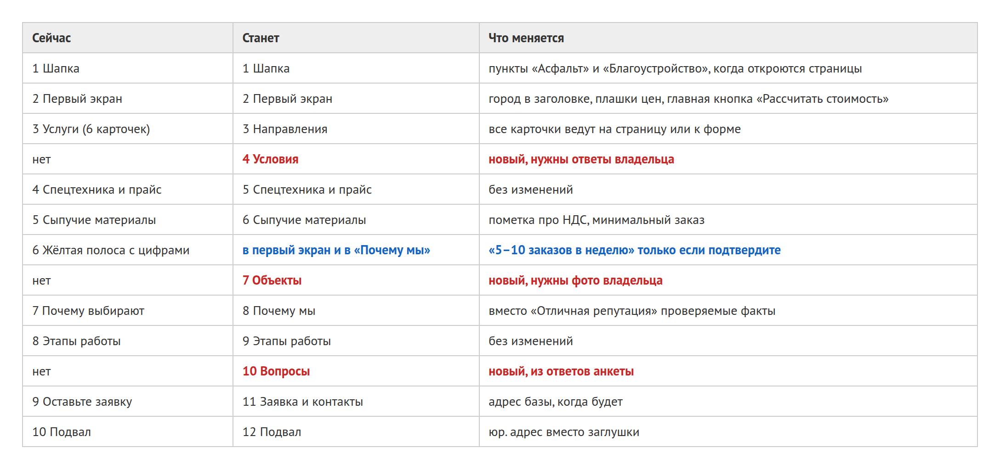
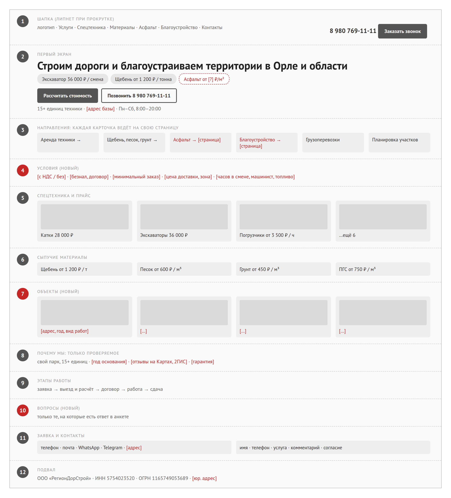
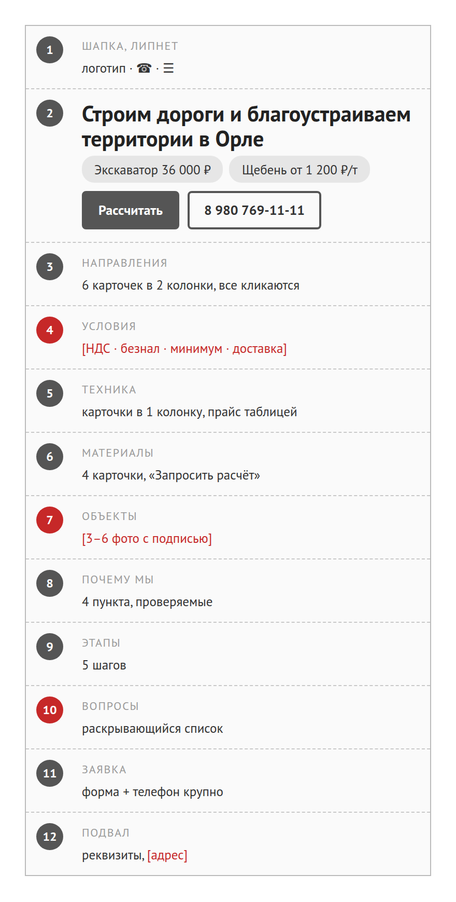

# Новая структура главной

Сейчас на главной десять блоков, и порядок у них разумный: сначала что делаете, потом техника и материалы с ценами, потом заявка. Ломать его я не предлагаю. Я бы добавил три блока: условия, объекты и вопросы. Про это и спрашивали «клиенты» в нашем тестовом прогоне, он описан в первом документе. Ещё убрать жёлтую полосу с цифрами в другие места и переписать «Почему мы».

Ниже одно и то же два раза: таблицей и макетом. Макет показывает только где что стоит. Цвета, шрифты и фото остаются как сейчас. Красным и в квадратных скобках то, чего на сайте пока нет и без вашего ответа не будет.

## Было и стало

## Макет, компьютер

## Макет, телефон

{width=42%}

## По блокам

| № | Блок | Что делаем и зачем |
|--|--|--|
| 1 | Шапка | Остаётся. Теперь она липнет при прокрутке, так что телефон всегда под рукой. Когда откроются страницы асфальта и благоустройства, добавить их в меню. |
| 2 | Первый экран | Город в заголовок, под ним плашки цен, как на страницах аренды и материалов. Главную кнопку назвать «Рассчитать стоимость»: так понятнее, что будет после нажатия. |
| 3 | Направления | Те же шесть карточек, но каждая куда-то ведёт: на свою страницу или к форме с уже выбранной услугой. Сейчас нажимаются две из шести. |
| 4 | Условия, новый | Одна строка: НДС, безнал и договор, минимальный заказ, доставка, что входит в смену. Это главный вопрос прорабов и снабженцев в тесте. Нужны ответы 9–13 анкеты. |
| 5 | Техника и прайс | Без изменений, это лучший блок сайта. |
| 6 | Материалы | Добавить пометку про НДС и минимальный заказ, когда будут ответы 11 и 13. |
| 7 | Объекты, новый | 3–6 фото с адресом, годом и видом работ. Нужны ваши фото и права на них, вопрос 18. Без объектов этого блока нет совсем, пустым его не показываем. |
| 8 | Почему мы | Вместо «Отличная репутация» то, что можно проверить: свой парк, сколько лет работаете, ссылка на отзывы на Картах. Цифры из жёлтой полосы переезжают сюда, если вы их подтвердите. |
| 9 | Этапы | Без изменений. Пятый этап поправить, если гарантии с конкретным сроком нет. |
| 10 | Вопросы, новый | Только те вопросы, на которые вы ответили в анкете. На страницах услуг такой блок уже собирается сам из ответов. |
| 11 | Заявка | Добавить адрес базы или офиса и один срок ответа вместо двух. |
| 12 | Подвал | Юр. адрес вместо заглушки. |

## Почему так

Условия стоят сразу после направлений, до прайса. Застройщик в тесте нашёл цену автогрейдера за полминуты, а потом долго искал, что в неё входит, и так и не нашёл. Поэтому строку я бы поставил прямо над прайсом.

Объекты стоят после материалов, а не в конце. Проверить, что фирма настоящая, в тесте пытались двое: человек по рекомендации и специалист из администрации. Им было не за что зацепиться. Блок в самом низу они бы просто не увидели: на телефоне главная длиной около 14 тысяч пикселей, это шестнадцать экранов прокрутки.

Блоки 4, 7 и 10 без ваших ответов просто не покажутся, как сейчас не показываются страницы асфальта и благоустройства.

## Страницы аренды и материалов

Их порядок трогать не нужно. После правок 28 октября у них в первом экране три цены и номер, и проверяющий трижды ставил нашу аренду выше страницы конкурента. Единственное, чего им не хватает, это та же строка условий над прайсом. Блок «Этапы работы» на странице аренды сейчас описывает стройку, а не аренду. Его стоит переписать под аренду, но текст шагов должен дать человек, который сдаёт технику.
