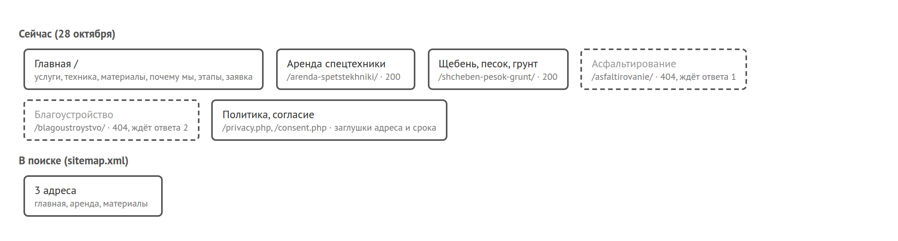
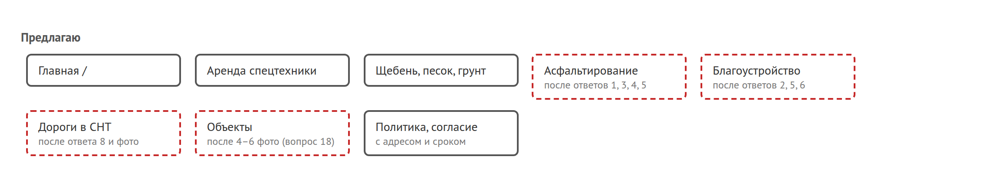

# Карта сайта, пути к заявке и поиск

Сейчас у сайта три открытые страницы и две закрытые. Закрытые не сломаны, они ждут ваших ответов в анкете и откроются сами, как только ответ появится в админке.

## Что есть сейчас

Асфальтирование и благоустройство отдают 404 нарочно. Без ваших слов о том, какие работы вы делаете, там было бы нечего написать, а выдумывать за вас я не стал. Страницы аренды и материалов открыты и попали в sitemap.xml, всего там три адреса.

## Как человек оставляет заявку

Путей шесть, и все рабочие. Кнопки «В аренду» проверяли на живом сайте, остальное тестами на копии сайта перед выкладкой. До правок 28 октября два пути были с дырой. Кнопка «В аренду» на карточках техники выглядела как кнопка, но ничего не делала. А окно «Запросить расчёт» обещало посчитать объём и доставку и при этом не давало написать ни объём, ни адрес. Сейчас кнопка открывает окно с названием техники, а в окне есть поле для комментария.

Что я видел в тесте. 32 прогона: 16 разных людей, каждый с телефона и с компьютера. Ни один прогон не закончился тупиком. Номер находили быстро: прораб на странице аренды позвонил бы с первого касания. Застревали не на кнопках, а на вопросах, ответа на которые на сайте нет:

- сколько стоит доставка и возите ли в Мценск (фермер, дачник, дизайнер);
- что входит в смену: часы, машинист, топливо (прораб, застройщик, бригадир);
- выставите ли счёт с НДС на щебень (снабженец);
- делаете ли асфальт во дворе, на парковке, дорожку к дому, и сколько это стоит (УК, кафе, пенсионер);
- делаете ли плитку, газон, заезд (молодая семья);
- где вы находитесь и есть ли примеры работ (администрация, человек по рекомендации).

Из 32 прогонов задачу целиком решили 6, остальные 26 частично. «Частично» почти везде значит одно и то же: заявку оставить можно, а решить, звонить ли именно вам, нечем.

## Что предлагаю

Новые страницы те же, что в анкете, плюс одна. Асфальт и благоустройство откроются после ответов на вопросы 1 и 2. Дороги в СНТ лучше вынести отдельно: председатель СНТ в тесте не нашёл на сайте ни слова «СНТ», ни отсыпки. Страница «Объекты» нужна, когда будет хотя бы 4 фото с адресом и годом.

Каждая новая страница попадёт в sitemap сама, руками ничего добавлять не надо.

## Как сайт ищется

Нашего сайта в ответах поиска пока нет. Я проверял 25 разных запросов, часть дважды: аренда техники, щебень, песок, грунт, асфальт, благоустройство и само название. Яндекс напрямую не пустил, показал капчу, так что про позиции в Яндексе я ничего утверждать не буду, ни плохого, ни хорошего. Я думаю, сайт просто ещё не проиндексирован: на нынешний хостинг и домен он переехал 27 октября. Но это моё предположение, проверить его можно только в Вебмастере.

По названию «РегионДорСтрой» поиск выдаёт двух тёзок: фирму из Кореновска и фирму из Ногинска. Пока у сайта нет адреса, отличить вас от них Яндексу не по чему.

С технической стороны сайт готов. У всех трёх страниц есть заголовок, описание и ссылка на себя как на основную, есть разметка организации, sitemap и robots.txt. Админка закрыта от поиска.

Чего не хватает, и это может сделать только владелец:

1. Подтвердить сайт в Яндекс Вебмастере и Google Search Console, добавить sitemap, отправить три страницы на переобход. Как это сделать, по шагам расписано в docs/SEO-OWNER-GUIDE.md. Яндекс пишет, что переобход «занимает не более трех дней».
2. Указать адрес. Справка Яндекса прямо говорит, что регион «не будет определена автоматически, если на сайте не указаны номер телефона, физический или юридический адрес». Телефон у нас есть, адреса нет.
3. Завести карточку в Яндекс Бизнесе и 2ГИС, обе бесплатные. Через карточку Яндекс присваивает регион сам.

Без этих трёх шагов из поиска к нам почти никто не придёт, только те, кому вы сами дали адрес сайта.
