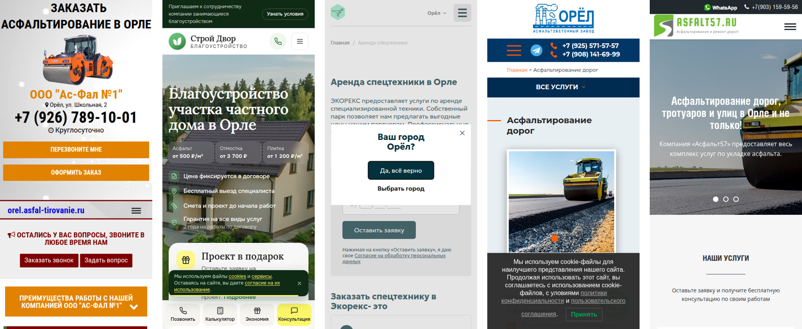

# Конкуренты в Орле: что у них есть, чего нет у нас

Смотрел 28 октября. Брал тех, кто попадается по нашим запросам: «аренда спецтехники Орёл», «щебень Орёл купить с доставкой», «асфальтирование Орёл», «благоустройство территории Орёл». Цены ниже переписаны с их страниц как есть, проверять их я не звонил.

Сразу про выдачу. Нашего сайта в ответах поиска пока нет ни по одному запросу. Яндекс напрямую я посмотреть не смог, он показал капчу, так что позиции в Яндексе ниже нигде не указаны. В ответах чаще всего стоят не фирмы, а площадки: Яндекс Услуги, Профи, perevozka24, stroitaxi, 2ГИС, Zoon.

## Первые экраны с телефона

Слева направо: Ас-Фал №1 (асфальт), Строй Двор (благоустройство), Экорекс (аренда), АБЗ Орёл (асфальт), Асфальт57.

## Таблица

| Сайт | Что продаёт | Цена на сайте | Чем берёт | Что мешает |
|--|--|--|--|--|
| orel.asfal-tirovanie.ru | асфальт | «от 350 р за м2» в первом экране, мелкозернистый «от 450 р/м2», ямочный ремонт «от 550 р/м2» | адрес «Орёл, ул. Школьная, 2», «Круглосуточно», длинный прайс по видам работ, 4 отзыва | гарантия «от 1 месяца и более», 6 фото без подписей |
| orel.blago-s.ru | благоустройство | плитка «от 1 200 ₽/м²», асфальт «от 500 ₽/м²», под ключ «от 70 000 ₽/сотка» | гарантия 2 года, 3 объекта с ценой, калькулятор, панель звонка внизу экрана | баннер cookie поверх первого экрана |
| orel.ecorex.ru | аренда (сайт про отходы) | «от 1900 руб./час» | в первом экране форма и условия: нал и безнал, договор, отсрочка платежа | окно «Ваш город Орёл?» закрывает форму, в шапке металлолом |
| abzorel.ru | асфальт | «200 руб./м2», но «исходя из стандартных условий и площади от 1000 м2» | свой асфальтовый завод, скидка 5% при предоплате | гарантии нет, баннер cookie закрывает низ экрана |
| ereda-orel.ru | аренда | цен нет | «Быстрая подача техники на объект в Орловской области» | формы нет |
| stroitaxi.ru/orel | площадка аренды | колёсный экскаватор 1800 ₽/час, щебень доломит «≈ 1050 ₽ / тонна» | отдельные страницы под каждый вид техники и материала | это не фирма: заявку разбирают чужие владельцы техники |
| pesok-orel.ru | песок, грунт | карьерный песок «от 350 ₽ с НДС», грунт «от 350 ₽ с НДС» | «без посредников», свой карьер, минимум 10 м³, работают с НДС и без | единица у цены не указана |

## Порядок блоков

У Ас-Фал №1 главная очень длинная, заголовков больше тридцати. Сначала преимущества и услуги, потом своя техника, гарантии, прайс, районы Орла, фото, отзывы, вопросы и форма. Прайс примерно в середине, но цена «от 350» уже в первом экране, так что листать до него не обязательно.

У Строй Двор, если верить пересказу страницы, 17 разделов: услуги, работы по Орлу и области, цены, от чего зависит стоимость, примеры работ, почему мы, как работаем, как заказать, подарок, спецпредложения, мастера, отзывы, вопросы, контакты. Самое сильное у них в первом экране: три цены плашками и четыре строки про договор, выезд, смету и гарантию.

У Экорекса страница аренды короткая: заголовок, форма, «Заказать спецтехнику в Экорекс это...» и список техники.

У нас на главной шесть разделов с заголовками: услуги, техника, материалы, почему мы, этапы, заявка. На странице аренды четыре. Короче, чем у всех, и это скорее плюс, если в первом экране уже есть цена и телефон. Сейчас на страницах аренды и материалов они там есть.

## Где мы сильнее

Цены по моделям. Ни у кого из просмотренных по аренде нет такого прайса, как у нас: Hyundai 170W-7 за 36 000 ₽ / смена, Hidromek HMK 102B за 3 500 ₽ / ч, Bomag BW 211D-40 за 28 000 ₽ / смена, и всё с НДС. У Эреды цен нет совсем, у Экорекса одна строка «от 1900 руб./час».

Первый экран страницы аренды. Я давал наши страницы и страницы конкурентов отдельному проверяющему, он не знал, где чья. Нашу аренду он трижды поставил выше Экорекса: у них окно выбора города и шапка про металлолом, у нас три цены и кнопка «Позвонить 8 980 769-11-11».

Скорость. Страницы аренды и материалов на телефоне открываются за 1,0–1,1 с до главной картинки, Lighthouse даёт 100 из 100 по скорости.

## Что взять

1. Строку условий у Экорекса: нал или безнал, договор, отсрочка, минимальное время заказа. У нас ничего этого нет, а прорабы в тесте спрашивали именно это. Нужны ваши ответы, тогда строка встанет над прайсом.
2. Четыре строки доверия у Строй Двор: цена в договоре, бесплатный выезд, смета до работ, гарантия. Писать можно только то, что вы реально делаете. Выезд, замер и гарантия есть в анкете, вопросы 5 и 6.
3. Адрес в первом экране, как у Ас-Фал №1 («ул. Школьная, 2»). У нас адреса нет нигде, а без него Яндекс не присвоит сайту регион.
4. Цену асфальта за м² и минимальную площадь. У Ас-Фал №1, АБЗ Орёл и Строй Двор она есть, от 200 до 550 ₽/м² в зависимости от вида работ. У нас страница асфальта закрыта, пока нет ответа на вопросы 1, 3 и 4 анкеты.
5. Объекты с адресом и суммой, как три примера у Строй Двор. Даже три штуки сильно лучше, чем ничего.

Не брать: баннеры cookie поверх экрана и окна выбора города. У нас их нет, и пусть так и остаётся.

## Куда ещё выйти, кроме сайта

| Площадка | Есть ли там конкуренты из выдачи | Сколько стоит | Что сделать |
|--|--|--|--|
| Яндекс Бизнес | в выдаче не проверяли | «Это бесплатно.» | завести карточку с адресом, часами и фото техники |
| 2ГИС | первый в ответе на «дорожное строительство Орёл» | «Это полностью бесплатно.», проверка 3–5 рабочих дней | то же, что в Яндекс Бизнесе |
| Яндекс Услуги | первые по «асфальтирование Орёл» и «аренда экскаватора Орёл» | продвижение за клик, сумм в справке нет | профиль организации |
| perevozka24 | в ответах по аренде и материалам | аренда спецтехники 980 ₽/мес или 8 890 ₽/год | объявления по технике |
| stroitaxi | в ответах по 6 из 7 повторных запросов | «от 10% только за успешные заказы» | уточнить у менеджера |

Без Метрики узнать, откуда пришёл клиент, можно только вопросом по телефону «откуда узнали». Его стоит задавать каждому.
